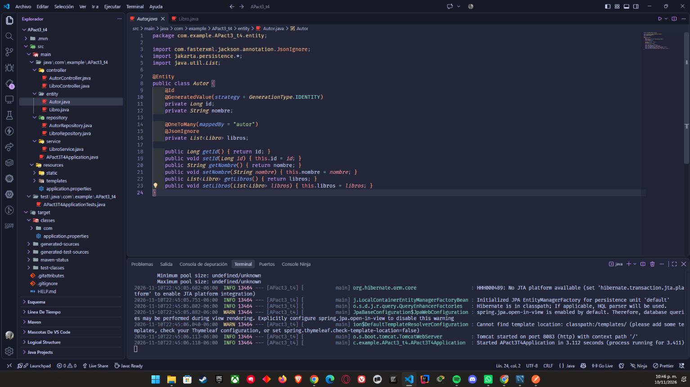
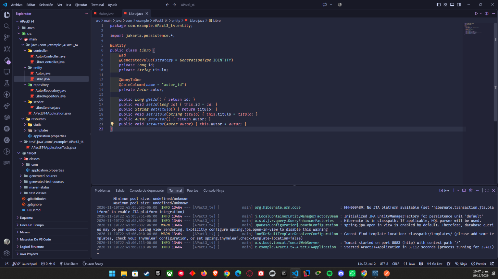
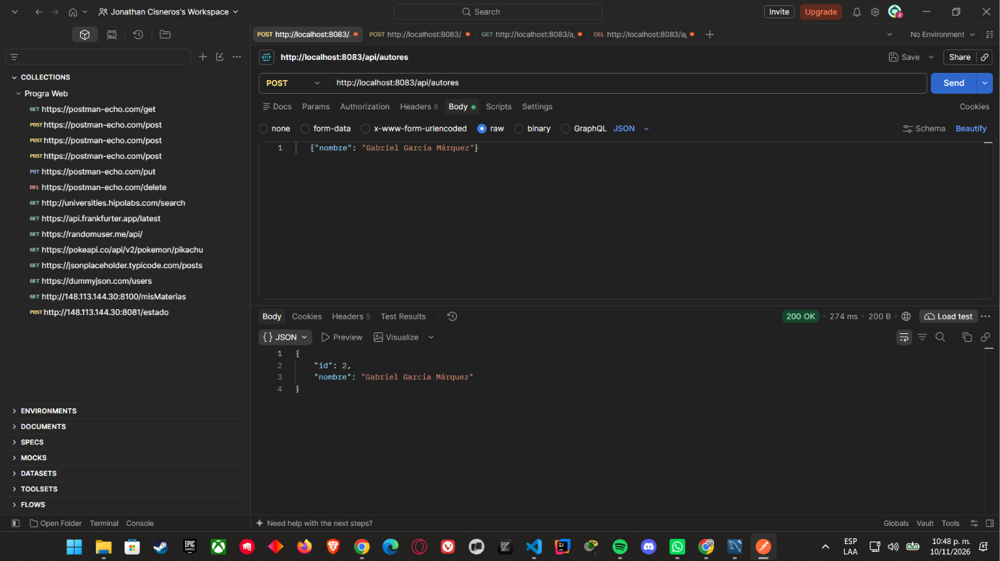
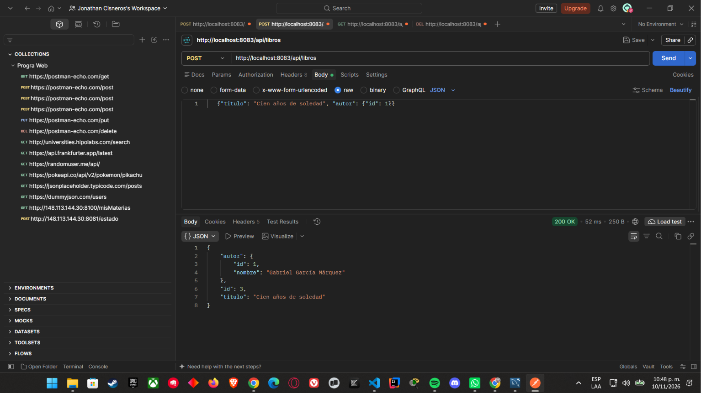
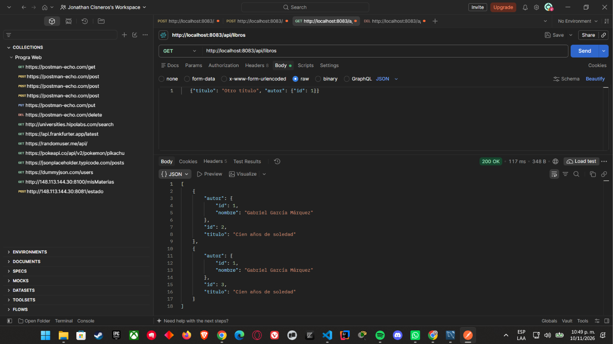
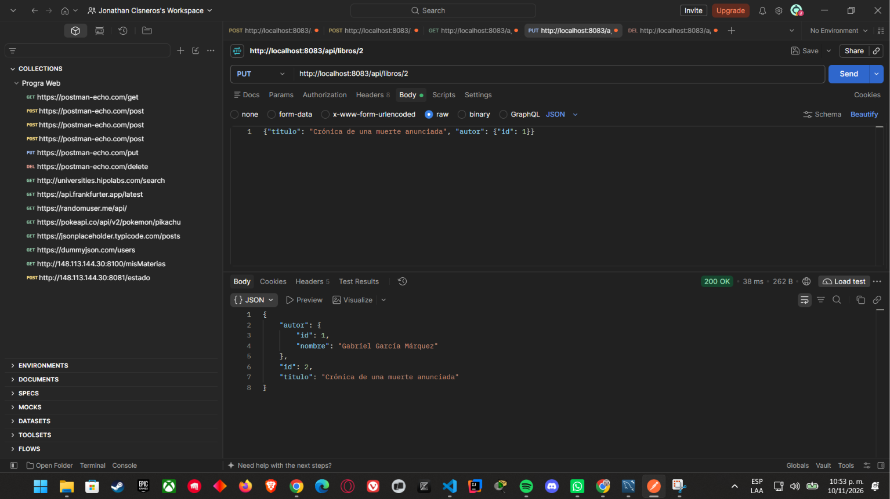
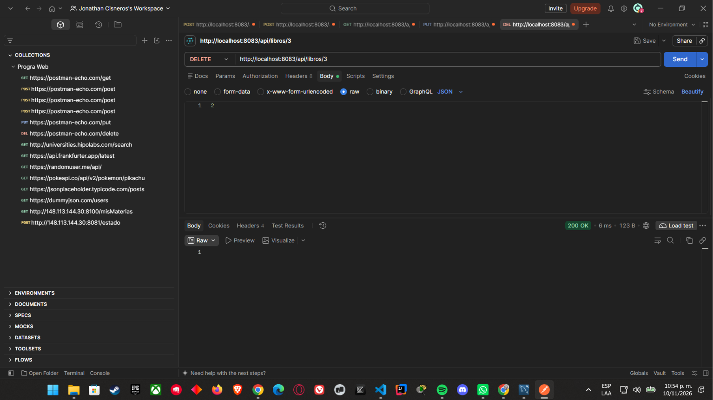
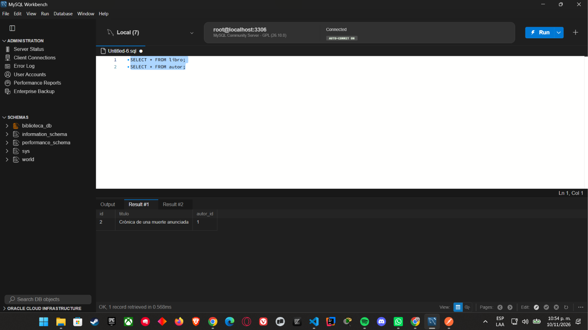
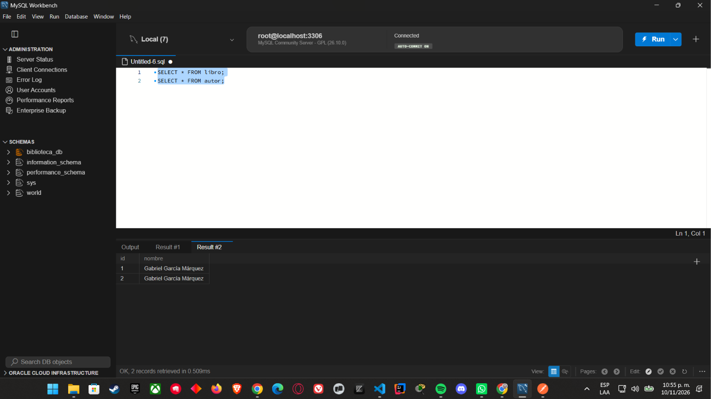
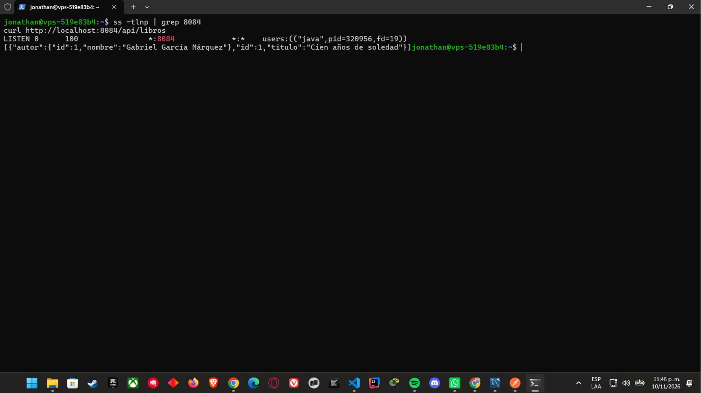

# Act3 - CRUD con Spring Boot y JPA (Libro / Autor)

CRUD completo en Spring Boot con MySQL. Relación: **muchos libros pertenecen a un autor** (`@ManyToOne` / `@OneToMany`).

## Entidades

- **Autor**: `id`, `nombre`. Tiene `@OneToMany(mappedBy = "autor")`.
- **Libro**: `id`, `titulo`, `autor`. Tiene `@ManyToOne` y `@JoinColumn(name = "autor_id")`, que es la llave foránea.




## Estructura del proyecto

- `entity`: Autor y Libro
- `repository`: AutorRepository y LibroRepository (JpaRepository)
- `service`: LibroService (lógica de negocio)
- `controller`: LibroController y AutorController

## Endpoints

| Método | URL | Descripción |
|---|---|---|
| POST | /api/autores | Crear autor |
| GET | /api/autores | Listar autores |
| POST | /api/libros | Crear libro |
| GET | /api/libros | Listar libros |
| GET | /api/libros/{id} | Ver un libro |
| PUT | /api/libros/{id} | Actualizar libro |
| DELETE | /api/libros/{id} | Eliminar libro |

## Capturas del CRUD

### Crear




### Leer (se ve el nombre del autor, no solo el ID)



### Actualizar



### Eliminar



## Base de datos

Tablas en MySQL Workbench, con la llave foránea `autor_id` en la tabla `libro`:




## Despliegue en VPS

El proyecto está corriendo en el VPS, en el puerto 8084, conectado a la base de datos `biblioteca_db`:

**http://148.113.144.30:8084/api/libros**

En la captura se ve el puerto 8084 escuchando y la respuesta de la API con el libro y el nombre de su autor:



## Cómo ejecutar

1. Crear la base de datos: `CREATE DATABASE biblioteca_db;`
2. Definir la contraseña como variable de entorno (PowerShell) y ejecutar:

```powershell
$env:DB_PASSWORD="tu_contraseña"
.\mvnw spring-boot:run
```

La app corre en `http://localhost:8084`.
